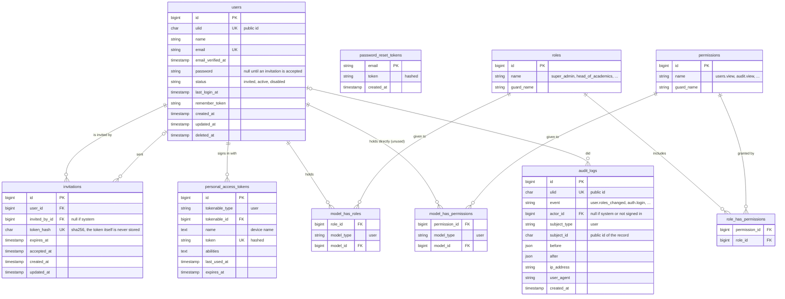

# Database diagram (ERD)

Tables that exist today (Phase 1). Each later phase adds its own tables here in the same change as its migrations.

Notes that apply to every table:

- `id` is an internal number. The API only ever shows the public `ulid` (26 characters) and never accepts the number.
- Times are stored in UTC.
- Business records use soft deletes (`deleted_at`). `audit_logs` is append-only and never changes.
- The default Laravel infrastructure tables (`cache`, `cache_locks`, `jobs`, `job_batches`, `failed_jobs`, `sessions`, `migrations`) are left out.

## How to read the access model

A user holds one or more **roles**. A role holds **permissions**. The API checks permissions (for example `users.invite`), never role names, except for one rule: `super_admin` passes every check. `model_has_permissions` (a permission given straight to a user) exists because the permission package creates it, but the application does not use it.

`audit_logs.subject_type` and `subject_id` point at the record that was acted on by a short type name and its public id. There is deliberately no foreign key: the history must survive even if the record is later removed.

## Planned (not built yet)

From the project brief, added phase by phase: `student_profiles`, `staff_profiles`, `programs`, `cohorts`, `academic_years`, `semesters`, `courses`, `course_offerings`, `enrolments` (Phase 2); `assessments`, `assessment_scores`, `semester_results`, `grade_scales` (Phase 3); `fee_structures`, `fee_items`, `invoices`, `invoice_lines`, `payments`, `payment_allocations`, `receipts` (Phase 4); `notices`, `notice_audiences`, `notice_reads`, `notifications` (Phase 5); `files` (as needed).
