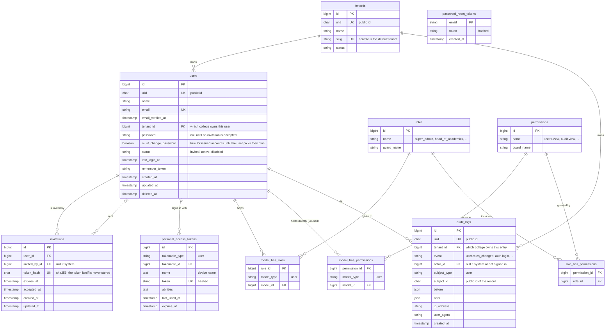
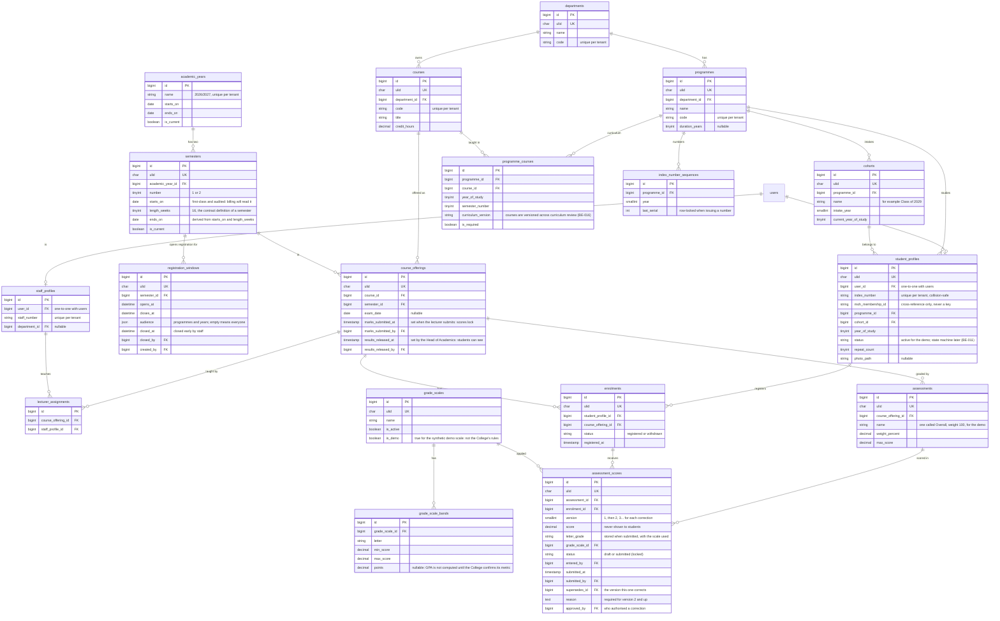
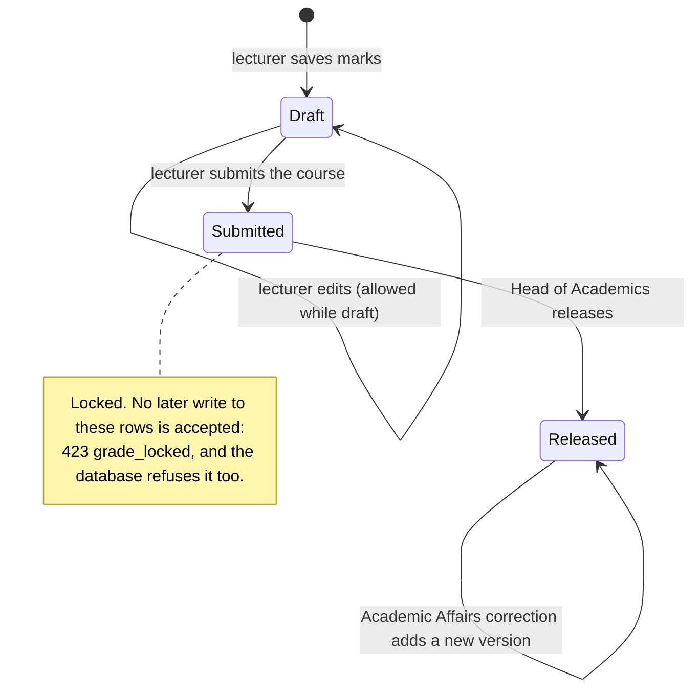

# Database diagram (ERD)

The first diagram shows the tables that **exist today**. Part 2 is the data model for the Slice 0 demo (student registration, mark entry, release, student results). **The tables, models, factories, synthetic data and the grade lock are built** (migrations of 2026-11-20); the endpoints on top of them are not, and field names will be adjusted to the frontend team's (D3). Each later phase adds its tables here in the same change as its migrations.

Notes that apply to every table:

- **Tenancy:** every domain table has a non-null `tenant_id` (foreign key to `tenants`) and every query is limited to the current tenant. It is built in and switched off: one default tenant owns everything (ADR 0010). The diagrams below omit `tenant_id` from the new tables to stay readable, but each of them has it, and any unique rule on a business value (for example a course code) is unique **per tenant**.
- Spelling follows the frontend and the contract: "programme", not "program".

- `id` is an internal number. The API only ever shows the public `ulid` (26 characters) and never accepts the number.
- Times are stored in UTC.
- Business records use soft deletes (`deleted_at`). `audit_logs` is append-only and never changes.
- The default Laravel infrastructure tables (`cache`, `cache_locks`, `jobs`, `job_batches`, `failed_jobs`, `sessions`, `migrations`) are left out.

## Tenancy in the tables above

`tenants` and `tenant_id` (on `users` and `audit_logs`) were added for multi-tenancy (ADR 0010).

Not tenant-scoped on purpose: `roles`, `permissions` and their links (the same eight roles apply to every college; a user's roles are reached through the user, who is scoped), `invitations`, `personal_access_tokens` and `password_reset_tokens` (they belong to a user, who carries the tenant), and Laravel's own infrastructure tables.

## How to read the access model

A user holds one or more **roles**. A role holds **permissions**. The API checks permissions (for example `users.invite`), never role names, except for one rule: `super_admin` passes every check. `model_has_permissions` (a permission given straight to a user) exists because the permission package creates it, but the application does not use it.

`audit_logs.subject_type` and `subject_id` point at the record that was acted on by a short type name and its public id. There is deliberately no foreign key: the history must survive even if the record is later removed.

## Part 2 - Slice 0 data model (built; endpoints still to come)

The demo flow: staff register a student; the student registers for courses; the lecturer enters, reviews and submits marks (which locks them); the Head of Academics releases the course's results; the student sees letter grades. See ADR 0011 for the decisions behind this design.

Also built: `audit_logs.reason` (text, nullable). Grade changes must say who, when and **why**.

The tables were checked against the frontend's admin dashboard (`docs/frontend-portal-review.md`): that is where `registration_windows` and `offerings.exam_date` come from. Two MariaDB 10.4 details worth knowing: `NOT NULL timestamp` columns get odd defaults there, so event times use `dateTime`; and index names must stay under 64 characters, so the long ones are named by hand.

### How marks and results move

- **Locking is enforced in the database,** not only in the code (built, and tested with raw SQL): the triggers `assessment_scores_locked_update` and `assessment_scores_locked_delete` reject any UPDATE or DELETE of a score row once its status is `submitted`. A correction is a **new row** (higher `version`, `supersedes_id`, a `reason`), never an edit. The current grade is the latest approved version.
- **What a student sees:** only the current submitted version of their own enrolment's scores, and only when the offering's `results_released_at` is set. The API returns the letter grade and credit hours, never the numeric `score` (BE-027).
- **Who may do what (permissions to add when built):** `students.register`, `enrolments.manage`, `marks.enter` (only for offerings the lecturer is assigned to, enforced by a query scope on `lecturer_assignments`), `marks.submit`, `results.release` (head_of_academics), `results.correct` (academic_affairs), `results.view-own` (student, own rows only).

### Open points (nothing here is decided by guesswork)

| # | Question | For the demo | Who decides |
|---|---|---|---|
| 1 | Is a mark one number, or continuous assessment plus exam with weights? The portal mentions "default weights" | One assessment called Overall (weight 100). The tables already allow several | Frontend files and the College |
| 2 | Grade scale and the GPA/CGPA metric (D5) | A synthetic scale flagged `is_demo`; no GPA; `points` empty | The College |
| 3 | Course-registration rules: credit limits, clashes, prerequisites, arrears gating (BE-065) | Not stored or enforced; registration only checks the course is offered in the current semester and not already taken | The College |
| 4 | Student status values and transitions (BE-011) | Only `active` | The College |
| 5 | Index number format (BE-008: abbreviation, programme, year, serial) | Placeholder `<programme code>/<year>/<4-digit serial>`, issued from `index_number_sequences` under a row lock | The College |
| 6 | Email is unique across the whole system today | Kept (sign-in has no tenant yet); becomes per-tenant when a second college is onboarded (ADR 0010) | Owner |
| 7 | Field names and shapes | Proposed; will follow the frontend's `app/Data` objects (D3) | Frontend engineer and owner |
| 8 | Registration window audience and statuses | `audience` is a JSON list; status is derived (not yet open, open, closed) | Frontend engineer |

### Later (not part of Slice 0)

Fees (`fee_schedules`, `fee_items`, `invoices`, `invoice_lines`, `payments` as append-only counter-entries in integer pesewas, `receipts`), announcements (`announcements`, `announcement_audiences`, `announcement_reads`), notifications, admissions and applicants, contestations, evaluations, clinical placements, stores, and files. Each is added with its own migration and its own section here.
